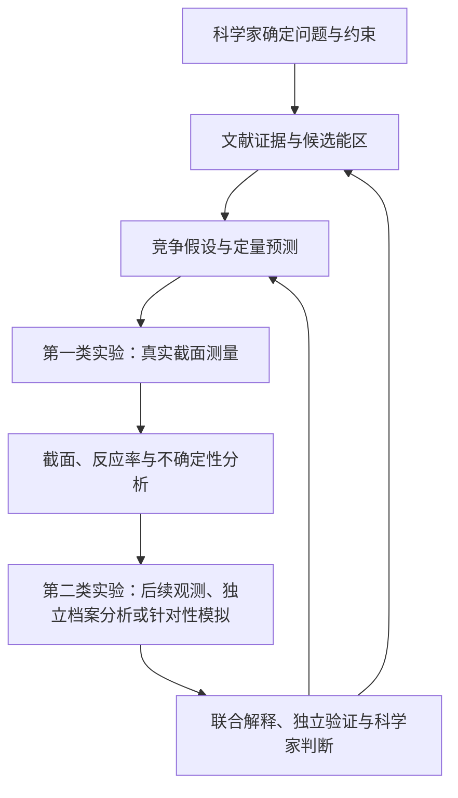

# Deepfield · 深空

**An AI-driven Nuclear Astrophysics Laboratory**

一次更精确的核反应测量，能改变我们对天体过程的哪些理解？

Deepfield 是一个面向核天体物理的 AI 科研实验室研究计划。以 JUNA / 锦屏深地核天体物理实验为应用与验证场景，探索如何让多智能体系统与科学家协作，将文献、物理假设、科研代码、真实测量和天体物理解释连接起来。

## 研究什么

核天体物理的问题横跨核结构、核反应、实验测量和天体环境。文献与数据分散，数值计算成本高，束流时间有限，而测量与模拟中的不确定性又会逐层传递到科学结论。

Deepfield 希望围绕具体反应问题回答：

- **测哪里：** 哪些反应和能区最值得测量？依据是什么？
- **怎么测：** 如何在装置条件和资源约束下设计实验、优化参数？
- **如何解释：** 新截面和反应率约束了哪些机制，又留下了哪些问题？
- **下一步做什么：** 哪种观测、独立数据分析或数值实验最能区分剩余解释？

## 一个 Loop，两类实验

研究计划将真实核反应截面测量与测量后的解释实验放在同一个科研循环中：

第二类实验由测量后仍未解决的科学问题驱动。Code Agent 需要主动提出有机制判别力的后续工作，并说明预期结果、所需证据和可否证条件。观测与模拟分别记录其证据性质。

## Agents Plan

| 角色 | 主要职责 |
| --- | --- |
| **Literature Agent** | 检索文献与核数据，整理证据、冲突、候选反应和关键能区，寻找可复用方法。 |
| **Hypothesis Agent** | 生成、评审和修正竞争假设，明确机制、定量预测及否证方式。 |
| **Code Agent** | 复现和复用科研代码，分析测量、计算反应率与天体物理后果，主动提出后续解释实验。 |
| **Experiment Agent** | 组织可执行测量方案、装置优化和运行反馈，协调后续观测需求。 |
| **Verification Agent** | 独立检查证据、计算、物理约束、适用范围和不确定性。 |
| **Supervisor / 协调器** | 管理任务依赖、共享状态、记忆、资源和断点恢复。 |

科学家贯穿整个流程：设定和修改研究目标，贡献领域知识，确认实际实验与观测方案，并判断关键科学结论。候选评审、排序和演化角色可先作为子任务实现，再依据评价决定是否独立拆分。

## Roadmap

| 阶段 | 重点 |
| --- | --- |
| 第 1–4 月 | 依次建设 Literature、Code、Hypothesis、Experiment 核心 Agent，并逐步接入共享工具、记忆和验证。 |
| 第 5 月 | 真实束流测量与截面、反应率分析。 |
| 第 6 月 | 执行后续解释实验，完成首个双实验 Loop。 |
| 第 7 月 | 集成验收、独立 Benchmark、基线与消融比较、研究产出。 |

月份按项目启动后的相对时间计算。实际束流和观测安排需要结合设施资源落实，能力验证与真实实验完成状态分别记录。
