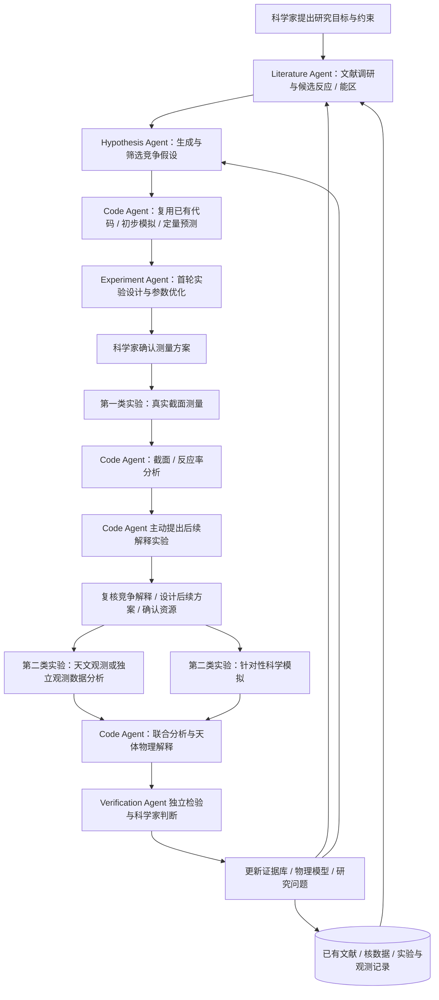
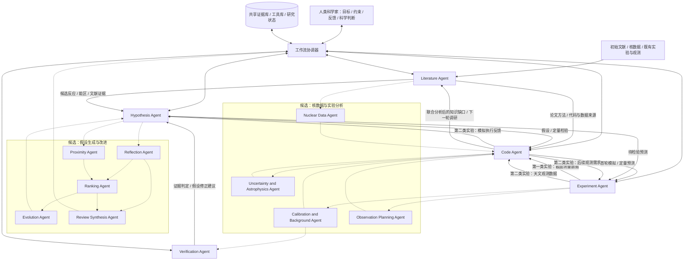

# DEEPFIELD - 深空

## 面向核天体物理的可控自主科学发现系统

**研究架构报告 · Version 1.1 · 2026-10-15**  
**定位：An AI-Driven, Human-in-the-Loop Nuclear Astrophysics Laboratory**  
**应用与验证场景：JUNA / 锦屏深地核天体物理实验；**

> **研究愿景**：构建融合 Agentic、Human-in-the-Loop 与递归自我改进（RSI）AI 核天体物理科研实验室。通过多智能体协作，自主开展文献研究、科学假设生成、代码复用与开发、实验设计与数据分析，并将真实截面测量与后续天文观测或模拟实验连接起来，持续形成和检验新的物理解释。科学家在研究过程中动态设定目标、提供判断并参与关键决策；系统则通过实验反馈、独立验证和自我反思，持续改进知识组织、工具代码、研究策略及模型能力。最终，探索能够长期积累科研经验、主动发现科学问题，并在人机协作中不断提升科学发现能力的核天体物理科学智能实验室。

### 1. 研究 Loop：从截面测量到后续解释实验

Deepfield 参考 [Robin](https://doi.org/10.1038/s41586-026-10652-y) 的“提出假设 → 实验 → 数据分析 → 建议补充实验 → 再分析 → 更新假设”组织科学发现。**同一个 Loop 包含两类实验：第一类是核反应截面测量，第二类是 Code Agent 根据测量结果主动提出的天文观测或针对性模拟实验。** 第二类实验承担类似 Robin 中后续 RNA-seq 的作用，用于追问测量结果意味着什么、哪些解释能够被区分，以及还需要什么证据。

| 环节 | 主要责任 | 科研动作与输出 |
| --- | --- | --- |
| 问题与候选能区 | Literature Agent + Hypothesis Agent | Literature Agent 提出候选反应、关键能区与文献依据；Hypothesis Agent 提出竞争机制、预测和可证伪条件；Code Agent 提供初步定量计算。 |
| 第一类实验：真实截面测量 | Experiment Agent + 人类实验团队 | 在 JUNA 的实际条件下设计、优化并实施测量，记录束流、靶材、探测器、本底、标定及原始数据。 |
| 测量后分析 | Code Agent | 优先复用已验证的分析代码，必要时适配或补充实现，提取截面及相关不确定性，计算反应率，检查实验与理论的差异并形成可复现分析。 |
| 主动提出第二类实验 | Code Agent，Hypothesis Agent 协同 | 根据新测量识别仍未解决的问题，提出具有机制判别力的天文观测、独立观测数据分析或模拟实验，明确预期结果及其解释。 |
| 第二类实验的执行与分析 | Code Agent / Experiment Agent + 科学家 | 数值实验由 Code Agent 实现和执行；新天文观测由 Experiment Agent 协助组织方案并与实际观测团队衔接；观测数据由 Code Agent 分析。 |
| 联合解释与下一轮研究 | 各 Agent + 独立验证 + 科学家 | 联合评估截面、反应率、模拟和观测证据，支持、修正或排除假设，更新知识库及下一轮研究任务。 |

第二类实验须由**第一类实验分析后的科学问题**驱动，而不只是绘图或重复运行同一程序。例如，截面测量约束了某个共振贡献后，Code Agent 可进一步提出比较竞争机制的数值实验、模拟核合成结果，或明确需要何种天文观测量来区分预测。

第二类实验可以采用新天文观测、独立档案观测数据分析或针对性数值实验。分别记录其证据性质：观测提供外部约束，模拟给出特定假设下的定量推演。模拟自洽性不能等同于独立观测验证。新观测的可获得性、时间安排与实际执行由科学家和观测团队确认。

### 2. MAS 架构与人机协作

MAS 参考 Robin 的文献、假设与数据分析协作方式，并为核物理任务增加专门的实验执行能力。各 Agent 共享有版本与来源的研究状态；工作流协调器维护依赖关系、预算和断点恢复。**研究方向描述需要攻克的能力，Agent 描述运行时的分工，两者不要求一一对应。**

| 角色 | 主要职责与交付物 | 方法参考 |
| --- | --- | --- |
| **Literature Agent** | 检索论文、核数据库、图表和补充材料，提出候选反应和关键能区，输出证据、冲突与知识缺口；定位论文代码、数据及可复用方法，提交工具候选。 | 参考 Paper2Agent，将论文方法连接到可测试、可调用的科研工具，结合面向核天体物理的检索与证据核对。 |
| **Hypothesis Agent** | 在文献和计算依据上生成、辩论、修正及筛选竞争假设，明确机制、预测、适用条件和否证方式；根据两类实验反馈更新假设。 | 参考 Co-Scientist 的生成、评审与演化；研究 XunZi 式领域训练和多模态融合，以及 IdeaScientist 式分角色训练。 |
| **Code Agent** | 优先检索、复现并复用已有科研代码，按需适配与扩展；已有实现无法满足任务时再开发新代码，分析截面测量，计算反应率及天体物理后果；主动设计并执行后续模拟实验，提出需要进一步获取的天文观测约束。 | 参考 ERA 的程序生成、执行、评分与反馈搜索，以及 Robin 中数据分析推动后续实验的机制。 |
| **Experiment Agent** | 将研究目标转为可执行方案，评估装置可达性，协调测量、参数优化和运行反馈；为后续天文观测组织需求、资源与执行计划。 | 参考 X-ray Scientist 的工具调用、模拟到实机及观测反馈；结合 SECAR 的离线多目标优化与在线贝叶斯优化。 |
| **Verification Agent** | 独立检查证据、单位、计算、物理约束、守恒律、量级、量纲、适用范围及不确定性等，记录争议与失败；组织独立复算和外部数据验证。 | 与假设提出和代码实现分工，以可复现计算及实验、观测证据评价结论。 |
| **Supervisor Agent（协调器）与人类科学家** | Supervisor Agent 管理任务、状态和资源；科学家确定目标、审查关键假设、确认实际实验与观测方案、处理分歧并判断科学结论。 | 参考 Co-Scientist 的任务调度，贯穿各模块的 Human-in-the-Loop。 |

**候选 Agent 与任务分解**：参考 [Co-Scientist 的专门 Agent 设计](https://arxiv.org/html/2502.18864v1#S3.SS3)，在现有核心角色下增加以下候选。Hypothesis Agent 已承担 Generation 的职责，协调器对应 Supervisor；候选角色按任务需求启用，可先作为子任务实现，再通过评价决定是否拆分为独立 Agent。

| 候选角色 | 职责与输出 | 协作位置 |
| --- | --- | --- |
| **Reflection Agent：假设评审** | 检查文献支持、推理漏洞、物理前提和可证伪性，提出反例、替代解释及待检验问题。 | 参考 Co-Scientist；为 Hypothesis Agent 提供批判性评审，Verification Agent 负责独立计算和实验后的证据核验。 |
| **Ranking Agent：候选排序** | 对假设及研究方案进行成对比较，综合科学价值、可检验性与资源需求，输出排序理由及评审分歧。 | 参考 Co-Scientist；辅助分配计算与实验资源，内部排名与物理证据分别记录。 |
| **Proximity Agent：相似性与多样性** | 识别重复或近似假设，构建机制邻域，发现互补解释与尚未覆盖的方向。 | 参考 Co-Scientist；支持候选比较与多样性维护，文献新颖性由 Literature Agent 联合核对。 |
| **Evolution Agent：假设改进** | 根据评审、排序和新证据修正、组合或拓展假设，保存父版本、修改理由及新增预测。 | 参考 Co-Scientist；协助 Hypothesis Agent 演化科学假设，程序实现与改进由 Code Agent 负责。 |
| **Review Synthesis Agent：评审汇总** | 汇总跨候选、跨轮次反复出现的问题、争议和研究缺口，形成下一轮生成与评审建议。 | 对应 Co-Scientist 的 Meta-review 角色；向 Supervisor 和 Hypothesis Agents 提供综合反馈。 |

图中实线表示核心协作关系，虚线表示可按任务启用的候选角色。

### 3. 系统关键组件与运行机制

参考 [Co-Scientist](https://arxiv.org/abs/2502.18864) 的四大关键组件，以**自然语言输入输出接口、异步任务框架、专门化 Agent、上下文记忆**作为系统骨架；围绕 Deepfield 的双实验 Loop，补充工具调用和科研产物管理，并将多模态融合与训练作为可逐步迭代的能力层。以下描述为 Deepfield 的拟建设方案。

#### 3.1 自然语言输入输出接口与合作工作空间

科学家通过自然语言提出研究目标、候选解释、资源约束和评价要求，并在研究过程中修改目标、补充证据与反馈。系统将其整理为可确认的研究任务，关联反应体系、能区与参考系、天体环境、已有数据和待解决问题；关键约束与变更以版本记录传递给相关 Agent。

系统以研究概览、假设卡片、实验计划、可运行代码、图表和证据报告呈现结果，支持从结论回溯到文献、数据和计算。科学家能够追问依据、比较竞争解释、调整计划并查看任务状态。

**合作工作空间**：交互式呈现证据链、数据、代码、假设分支和进度，支持科学家修改目标与约束、复核结果和反馈；保留数据可视化、科研写作与报告生成能力，使其服务于上述研究产物。

#### 3.2 异步任务框架与 Supervisor 调度

Supervisor Agent 将研究计划分解为有依赖关系的任务队列，依据任务状态、优先级、时间和资源预算分配专门 Agent。独立的文献检索、假设评审和模拟可以并行；依赖测量结果的截面分析及第二类实验提案，在上游数据就绪后启动。

任务记录输入数据与假设版本、执行 Agent、工具、预算、输出位置及完成标准；区分待执行、运行中、等待资源、已完成和失败状态。耗时模拟和实验通过运行标识追踪，支持结果回收、检查点、失败恢复与断点续研；恢复任务时先核对执行记录，避免重复提交同一实验操作。

Supervisor 定期汇总候选覆盖、评审分歧、证据缺口和资源消耗，决定继续探索、补充计算、等待实验、请求科学家判断或结束当前任务。研究目标、数据或假设版本改变时，标记受影响的下游结论并安排必要的复算。

#### 3.3 专门化 Agent 与协作接口

采用前述核心与候选 Agent 分工，为各角色配置任务指令、科学方法提示、可用工具和输出规范。Agent 可以使用不同模型或同一模型的不同任务配置；候选角色按任务启用，保持其独立评价和资源使用记录。

跨 Agent 交接统一携带任务标识、假设与数据版本、来源、适用条件、不确定性、输出产物和未解决问题。Reflection 与 Ranking 的评审结果供后续研究决策，Verification 的计算和证据核验单独记录；Code Agent 继续承担测量后分析及主动提出第二类实验的职责。

#### 3.4 上下文记忆与长期研究状态管理

建立可持久化的 Context Memory，支持跨 Agent、跨会话和跨实验轮次的研究延续。当前任务所需的模型上下文、共享研究状态、长期证据和原始科研产物分别管理，通过标识与来源关联。

| 记忆层次 | 保存内容 | 使用方式 |
| --- | --- | --- |
| **任务工作上下文** | 当前问题、约束、相关文献、假设、近期工具反馈及待办事项 | 为当前 Agent 按需组装；保留关键数值、单位、假设条件与数据标识。 |
| **共享研究状态** | 假设分支、评审和排序、任务依赖、两类实验进度、分歧及下一步计划 | 供 Supervisor 和各 Agent 读写，按版本追踪改变及受影响任务。 |
| **长期证据与经验记忆** | 有来源的文献与核数据、实验结论、失败案例、方法适用范围及科学家反馈 | 支持检索和经验复用，区分原始证据、暂定解释、已排除假设和待验证推测。 |
| **科研产物存储** | 原始能谱、探测器图像、观测数据、代码、环境、完整日志及模拟输出 | 保存完整文件和版本；上下文引用其标识、相关片段及可复现分析结果。 |

**读取与压缩**：按当前反应、能区、假设和实验阶段检索相关记忆，结合相关性、时效和上下文预算选取内容。长记录生成带来源的研究摘要；关键测量值、相关误差、适用条件、反证及未解决分歧须保留并可回查，完整产物独立存档。

**写入与更新**：每项结果记录来源 Agent、时间、输入版本及验证状态；新证据触发假设和结论版本更新，保留冲突与修改理由。待验证推测以明确标签进入记忆；过期结论注明失效原因，避免继续作为后续推理的既定依据。跨 Agent 并行写入采用独立任务记录，再按来源和版本合并。

**恢复与复用**：在关键工具完成、实验分析结束和 Loop 更新时保存检查点；恢复时加载目标、约束、任务状态、有效假设和必要产物，并核对运行中的计算或实验。知识与上下文的积累、执行策略调整和模型参数训练分别记录。

**共享数据库**：每个任务保存假设版本、候选能区与单位、文献依据、定量预测、实验或模拟配置、代码与环境版本、原始数据及处理记录、不确定性、证据判定和下一步问题。第二类实验提案还需列明竞争解释、判别性观测量、预期差异、资源需求与可否证条件。

#### 3.5 工具注册、调用与执行反馈

为各 Agent 提供可发现、可组合的工具接口，支持文献和数据库查询、数学计算、代码执行、物理模拟、数据处理、仪器状态读取及实验操作。工具可通过 MCP、API 或已有程序封装接入，注明用途、版本、输入输出格式、单位与能量参考系、适用范围、运行成本和调用条件。

| 工具类别 | 主要调用者 | 典型输入与输出 |
| --- | --- | --- |
| **文献、核数据与方法检索** | Literature / Hypothesis Agents | 查询、反应体系和约束 → 文献证据、数据表、方法及工具候选。 |
| **代码运行与科学模拟** | Code Agent | 代码、环境、物理参数和配置 → 执行状态、数值结果、诊断日志和科研产物。 |
| **测量与观测数据分析** | Code / Verification Agents | 原始数据、标定和分析配置 → 截面、反应率、观测约束及相关不确定性。 |
| **实验反馈与数值优化** | Experiment Agent | 仪器状态、待优化参数及目标 → 实际读数、候选设置、优化轨迹与执行记录。 |
| **证据与产物管理** | Supervisor 及各 Agent | 任务、数据和假设版本 → 可追溯记录、研究摘要、检查点及复现入口。 |

**调用闭环**：Agent 明确科学目的并选择工具 → 核对输入、单位和适用条件 → 提交执行并追踪运行 → 读取结果、错误和诊断信息 → 开展物理及数值检查 → 将结果写入研究状态并决定后续动作。工具执行成功、通过数值检查和获得科学证据支持分别标记，保留失败与空结果。

**文献到工具的接口**：借鉴 [Paper2Agent](https://doi.org/10.1038/s41586-026-11044-y)，将论文、代码、数据和教程整理为可调用资源。Literature Agent 提交方法与来源，Code Agent 建立运行环境、复现参考结果并封装工具；经验证后固定版本，注明输入输出和适用条件，再供其他 Agent 调用。

**代码与实验接口**：Code Agent 首先检索工具库和已有科研软件，复现参考结果并复用适合当前任务的实现；需要时先做适配与扩展，仍存在功能缺口时再参考 [ERA](https://doi.org/10.1038/s41586-026-10658-6) 生成新程序，并依据执行结果、误差与日志改进实现。Experiment Agent 参考 [X-ray Scientist](https://doi.org/10.1038/s42256-026-01261-5) 组织“动作 → 观测 → 调整”，调用数值优化器完成装置参数搜索。工具接入和实际操作依据实验设施既有流程，由获授权人员确认与执行。

对运行失败、超时或数据缺失进行分类处理，先诊断再决定修正参数、重试、替换工具或交由科学家处理。工具输出连同来源和版本进入上下文记忆，为后续假设修正、代码改进和实验调整提供反馈。

#### 3.6 多模态融合与模型能力迭代

**假设生成与多模态融合**：以 [Co-Scientist](https://arxiv.org/abs/2502.18864) 的生成、辩论与演化为推理流程，借鉴 [XunZi](https://doi.org/10.1038/s41551-026-01769-6) 联合文献推理和结构化科学数据。围绕同一反应、能区及天体环境，对齐文本证据、核数据表、截面与能谱曲线、能级及反应网络、模拟和观测结果；将数值预测与不确定性提供给假设评价，保留机制解释和证据来源。LLM 的自评置信度作为待校准的特征单独记录，与物理预测不确定性分别评价。

**训练与改进路径**：先建立现有模型、检索与代码工具协作的基线；在积累高质量样本后，研究 XunZi 式领域持续预训练和监督微调，以及 [IdeaScientist](https://arxiv.org/abs/2610.04074) 式分角色 LoRA / 强化学习。样本关联科学判断、证据、机制解释与可执行检验，生成草稿经专家复核。分别评价知识更新、提示与代码策略改进、模型参数训练的贡献，并记录计算成本。

### 4. 研究设计与指导原则

本版共六个研究方向。I 提供持续演化的知识和模型；II 研究假设生成；III 聚焦已有代码复用、必要的新代码开发、数据分析与科学模拟；IV 聚焦实验设计与优化；V 开展束流实验、天体实验和数值实验；VI 独立评估系统与各项改进的有效性。

整个设计强调 Human-in-the-Loop、证据可追溯、计算可复现和不确定性分析。近期围绕 JUNA 的具体任务建立完整 Loop，长期研究跨反应、跨天体环境及跨领域迁移。将“动态知识与证据对齐”“反馈驱动的科学决策”“两类实验对机制解释的增益”作为拟验证的方法贡献，以基线、消融和真实任务检验其价值。

| 方向 | 英文名称 | 研究核心 |
| --- | --- | --- |
| **I** | **Continual Knowledge-Guided Exploration & Model Discovery** | 动态证据库、模型发现、实验经验和长期研究状态 |
| **II** | **Hierarchical Scientific Hypothesis Generation** | 分层质疑、跨领域推理、竞争机制、假设生成与评价 |
| **III** | **Scientific Code Reuse & Development, Data Analysis & Simulation** | 优先复用已有代码、按需开发、截面分析、后续模拟实验及天体物理计算 |
| **IV** | **Scientific Experimental Design & Optimization** | 约束下的实验设计、装置优化与观测方案规划 |
| **V** | **Scientific Experimentation** | 束流实验、天体实验、数值实验 |
| **VI** | **Scientific Discovery Benchmarking & Evaluation** | 文献、假设、代码、实验四类 Benchmark 及完整 Loop 评价 |

**职责边界**：I 维护证据、模型和经验，II 提出科学解释，III 将任务实现为可运行分析与模拟并提出后续实验，IV 设计并优化可行方案，V 组织实施束流、天体和数值实验并解释结果，VI 评价方法贡献。Literature Agent 提出文献驱动的候选反应和能区，Code Agent 对其进行定量检验，Experiment Agent 评估和优化实际可执行性。

---

### I. Continual Knowledge-Guided Exploration & Model Discovery

**拟研究贡献**：多源科学证据的持续对齐、冲突处理及其对定量研究决策的贡献，以可追溯知识库和基线比较验证。

**科学问题**：如何使 Agent 在持续增长且可能相互矛盾的科学知识中，长期自主探索问题并发现可计算的科学模型？

- **I-A. Continual Scientific Knowledge Evolution**：持续阅读论文、图表、公式、代码及补充材料，整合 EXFOR、ENSDF、REACLIB/STARLIB 等核数据与实验记录；保留来源、时间、版本、单位、适用范围及冲突关系。关联原始数据与图像读取结果，建立论文、实验和科学问题清单，输出候选反应、能区及待核实问题，支持科学家共同补充想法和反馈。
- **I-B. Scientific World Model & Model Discovery**：建立能产生定量预测的模型集合，开展物理约束下的模型结构搜索、方程/程序合成、模型失配识别与结构更新；候选模型由 III 实现和检验。**Knowledge Base（证据记录）≠ World Model（机制与预测）**。
- **I-C. Scientific Experimental Records & Experience Management**：建立人机共建的结构化实验档案，持续记录实验配置、运行过程、原始数据、分析结果、异常事件及成功与失败经验，并关联科学假设、物理模型和相关文献，实现实验知识的可追溯积累、智能检索与复用。
- **I-D. Long-Horizon Research State Management**：维护数周至数月的研究任务、依赖图、假设分支、待办实验、失败记录和断点恢复能力；与知识库及经验记忆分离。

**交付物**：有证据溯源的动态知识图谱、可运行的候选模型、持续更新的实验记录、可恢复的科研轨迹。

### II. Hierarchical Scientific Hypothesis Generation

**科学问题**：如何从文献缺口、跨学科联系和模拟失配中提出新颖、物理合理、可检验的科学假设，并根据两类实验反馈修正解释？

- **II-A. Hierarchical Scientific Doubt**：建立从实验测量、核反应与核结构、核反应网络、天体物理过程到宇宙学及基础物理的分层质疑机制。主动检查已有理论的物理假设、近似条件、适用范围及尚未解释的异常，识别知识缺口与潜在科学问题。
- **II-B. Cross-Disciplinary Scientific Reasoning**：综合不同学科的理论、数学结构、物理机制和研究方法，开展跨领域知识迁移、机制类比、溯因推理与创造性假设生成；参考 IdeaScientist，按“问题—挑战—缺口—直觉—研究方案”组织想法，探索不同物理现象之间潜在的深层联系。
- **II-C. Autonomous Simulation-Guided Reasoning & Sensitivity Analysis**：向 Code Agent 提交待检验假设与计算需求，由 III 实现并执行核反应、核合成、恒星演化及其他相关物理模拟；通过参数扫描、敏感性分析、不确定性传播及竞争机制比较，识别主导物理参数、关键反应、模型失配与异常预测，使模拟成为主动发现科学问题和生成假设的重要途径。
- **II-D. Causal & Mechanistic Hypothesis Generation**：从观测现象、理论分析和模拟结果中提出候选物理机制、因果解释及竞争性科学假设，分析不同机制之间的联系与差异，推导其物理后果、可观测预测及相应的不确定性。
- **II-E. Open-World Hypothesis Generation**：在已有证据基础上识别现有理论的解释缺口，探索未预先枚举的假设、新的物理变量、作用机制、理论联系和科学问题；必要时向 I 提出模型构建与修正需求。
- **II-F. Hypothesis Refinement, Robustness & Falsifiability**：参考 Co-Scientist 组织生成、独立评审、相对比较和演化，结合两类实验反馈、敏感性分析和科学家交互，检验候选假设对参数变化、模型选择及不确定性假设的稳健性，明确其物理前提、适用范围、关键预测与可证伪条件，持续细化、合并或淘汰假设。
- **II-G. Scientific Hypothesis Evaluation & Selection**：建立考虑不确定性、敏感性及科学价值的定量假设评价与组合筛选方法，综合科学重要性、新颖性、物理合理性、预期知识增量、关键参数敏感度、预测不确定性、可证伪性与研究可行性，结合统计推断、多目标优化和稳健决策，识别高价值、具有互补性且值得进一步实验检验的科学假设集合。

**核心思想**：以分层质疑和跨学科推理拓展科学问题空间，以自主模拟、敏感性分析和不确定性传播识别关键物理机制及知识缺口，通过科学假设的生成、稳健性检验和定量筛选，形成从已有知识出发、通过独立证据核验新颖性与可检验性的科学发现过程。

**交付物**：包含机制、定量预测、文献来源、竞争解释与否证条件的假设卡片，以及可追溯的评价和更新记录。

### III. Scientific Code Reuse & Development, Data Analysis & Simulation

**科学问题**：如何让 Code Agent 优先复现并复用已有科研代码，在必要时适配、扩展或开发新代码，分析真实截面测量，并主动设计后续观测或模拟实验以推进天体物理解释？

**执行顺序**：检索已有工具与代码 → 复现参考结果并检查适用范围 → 优先复用 → 必要时适配与扩展 → 仍有缺口时开发新代码 → 验证并归档供后续复用。开发前记录已有工具不能满足任务的具体原因。

- **III-A. Research Code Discovery, Reproduction & Reuse**：优先检索共享工具库及 Literature Agent 提供的论文和代码，理解并复现已有核反应、核合成及恒星演化软件，建立运行环境、核对参考结果及适用范围；通过配置、接口封装和必要的适配完成任务，归档可重复调用的工具。
- **III-B. Targeted Code Extension & New Software Development**：当已有代码经配置与复用仍无法满足任务时，先评估局部扩展；确有新实现需求时再参考 ERA 编写程序，将候选实现及修改组织为可追溯的代码搜索；根据执行日志、数值误差、物理检查与计算成本改进方案。评价包含基准复现、单位一致性、守恒与正定性要求、数值收敛及独立算例。
- **III-C. Cross-Section Data Analysis & Inference**：优先调用已有标定、能谱处理、峰识别、本底建模、探测效率校正和似然拟合工具，按需补充分析代码，提取截面、反应率及统计和系统不确定性。参考 Robin 的多轨迹分析，比较不同合理分析选择下的稳定性，保留共识、分歧和可复现记录。
- **III-D. Follow-Up Observation & Simulation Design**：第一类测量分析后，Code Agent 必须形成后续解释实验提案：列出未解决的物理问题、竞争机制、需要的天文观测量或数值实验、预期差异及判别条件。与 Hypothesis Agent 复核解释，与 Experiment Agent 评估资源；后续实验可围绕异常结果、仍未收紧的约束或已被测量排除的解释展开。
- **III-E. Scientific Simulation & Astrophysical Analysis**：优先配置并运行已有核反应、反应网络和恒星模型软件，按需扩展或实现缺失的模拟功能，分析反应率变化对丰度、反应流、能量产生及任务相关观测量的影响；开展不确定性传播、竞争模型比较和反事实模拟，分析新取得或独立档案中的天文数据。昂贵计算可采用经独立验证的代理模型加速。
- **III-F. Executable Research Artifacts**：输出代码、环境、参数、数据处理记录、模拟结果及验证报告，生成与计算对应的图表、交互可视化、必要的科学动画及 LaTeX / Markdown 科研文档，使科学家能够运行、复核和继续修改研究。

**交付物**：可执行分析与模拟代码、截面和反应率及其不确定性、Code Agent 主动提出的第二类实验方案、天体物理预测与可复现计算档案。

### IV. Scientific Experimental Design & Optimization

**科学问题**：如何把候选科学问题和 Code Agent 的后续实验提案，转为满足仪器、观测资源及预算约束的可执行方案，并依据实际反馈调整？

- **IV-A. Quantitative Experimental Design Formulation**：建立实验设计的数学与统计学框架，明确待测物理量、竞争假设、实验参数、观测模型、统计与系统不确定性及实际约束，利用信息增益、参数精度、模型判别能力等指标定义实验优化目标。
- **IV-B. Optimal Experimental Design & Optimization**：结合贝叶斯实验设计、信息论与数值优化算法，在文献提出的候选能区内，联合优化测量点、束流参数、靶材、探测器配置、测量时间及资源分配；考虑物理模型、实验本底、探测效率和 JUNA 实际运行条件，参考 SECAR 的离线模拟与多目标优化，生成具有科学价值的可行方案，呈现不同目标之间的权衡；装置模拟由 III 提供。
- **IV-C. Adaptive Experimental Design & Sequential Optimization**：基于序贯实验设计、贝叶斯更新与主动学习，根据模拟预测、预实验结果、实际测量数据和科学家反馈，参考 SECAR 的在线贝叶斯优化，动态更新实验参数、测量策略与资源分配，实现实验方案的持续改进。

- **IV-D. Experimental Workflow & Feedback Design**：参考 X-ray Scientist，设计仪器状态、探测器图像、能谱和日志的工具接口，以及“规划动作—执行—读取反馈—调整”的测量流程；先在模拟或历史运行回放中检验，形成供 V 实施的运行方案。
- **IV-E. Follow-Up Observation Coordination**：依据 Code Agent 提案评估第二类实验的资源需求、数据覆盖和判别能力，形成天文观测申请或档案数据获取计划，与科学家和观测团队协调资源，供 V 组织实施；针对性数值实验由 Code Agent 执行。

**核心思想**：Physics-informed, uncertainty-aware, and information-driven experimental design，将物理模型、统计推断与实验优化真正结合起来。

**交付物**：可执行的截面测量与后续观测计划、装置优化方案、标定与数据采集流程，以及资源分配和反馈调整策略。

### V. Scientific Experimentation（实验实施）

**科学问题**：如何开展束流实验、天体实验和数值实验，获得能够检验假设、解释物理机制并推动下一轮研究的科学结果？

- **V-A. Beam Experiments（束流实验）**：由 Experiment Agent 与人类实验团队在 JUNA 等实际装置上实施核反应截面测量，完成束流与探测器标定、实验本底测量、数据采集及必要的重复测量；将原始数据、运行条件和标定信息交给 Code Agent 提取截面与反应率，并分析统计及系统不确定性。
- **V-B. Astrophysical Experiments（天体实验）**：根据 Code Agent 在截面分析后提出的解释需求，与科学家和观测团队开展针对性天文观测，或获取并分析独立档案观测数据；比较核物理测量所约束的模型预测与实际天文观测，检验竞争机制及其天体物理后果。
- **V-C. Numerical Experiments（数值实验）**：由 Code Agent 优先复用并运行已有核反应、反应网络和恒星模型代码，开展参数扫描、控制变量、竞争机制及反事实模拟，传播测量不确定性，比较测量前后对丰度、反应流、能量产生及相关观测量的影响；必要时适配或开发新代码。

**闭环衔接**：束流实验构成第一类实验；测量后由 Code Agent 主动提出的天体实验或数值实验构成第二类实验。三类实验分别保留数据、配置、代码和结果，记录支持、排除及尚无法区分的解释；经独立核验与科学家判断后，将新约束、负结果和未解决问题反馈至知识库与下一轮假设。模拟推演与独立观测证据分别报告。

**交付物**：束流测量数据及截面结果、天文观测或档案数据分析结果、可复现数值实验，以及联合物理解释和下一轮研究问题。

### VI. Scientific Discovery Benchmarking

**科学问题**：如何围绕文献、假设、代码和实验建立可复现的 Benchmark，评价各 Agent 的能力及完整科研 Loop 的科学价值？

- **VI-A. Literature Benchmark（文献）**：评价文献检索、图表与公式理解、核数据提取、证据溯源和冲突识别，以及候选反应与关键能区的文献依据；通过参考文献、原始数据及专家标注核对准确性、覆盖度和引用可靠性。
- **VI-B. Hypothesis Benchmark（假设）**：评价假设的新颖性、物理合理性、机制解释、可检验性与可证伪性，以及根据新证据修正假设的能力；结合独立文献核对、专家评审、定量计算与后续实验评价，分别记录内部排名和外部证据支持。
- **VI-C. Code Benchmark（代码）**：评价已有代码的发现、复现、复用与适配，以及必要的新代码开发能力；核对运行成功率、参考结果复现误差、单位与物理约束、数值收敛、不确定性处理和计算成本，并检验截面分析、天体模拟及后续解释实验提案的可复现性。
- **VI-D. Experiment Benchmark（实验）**：评价实验设计、约束满足、参数优化、执行反馈和测量可靠性；在匹配资源预算下比较测量效率、截面不确定性及信息收益，并检验第二类观测或模拟实验是否区分竞争机制、改善天体物理解释。历史回放、模拟与前瞻性真实实验分别报告。

**共同评测原则**：按论文时间、反应体系或实验批次设置独立测试，核对数据重叠；比较人工流程、基础 Agent 与完整 MAS，并通过消融评价工具、记忆、多模态融合及候选 Agent 的贡献。保留“仅截面测量与分析”对比“主动提出第二类实验的完整 Loop”的评价，记录人类介入、计算和实验成本。

**交付物**：文献、假设、代码和实验四类 Benchmark、独立测试集与评价协议、基线及消融结果，以及完整 Loop 的科学贡献报告。

### 5. 首个完整 Loop 的验收与工作示例

**近期验收目标**：围绕一个经科学家确认的核反应问题，完成文献驱动的候选能区与假设、一次真实截面测量及可复现分析、Code Agent 主动提出并完成的一项后续观测分析或模拟实验，以及测量前后天体物理结论的比较。观测和模拟按实际证据类型验收，尚未执行的观测申请标记为待完成任务。历史数据回放可用于开发和评测，前瞻性闭环的截面测量需由真实实验完成。

**工作示例（示意，非已证实发现）**：Literature Agent 在文献和核数据中识别某反应的候选关键能区及冲突证据；Hypothesis Agent 提出竞争共振机制；Code Agent 复现已有计算并预测截面和天体物理后果；Experiment Agent 在 JUNA 条件下组织测量。测量后，Code Agent 提取截面和反应率，识别仍无法区分的解释，主动提出不同机制下的核合成模拟，或提出可区分其预测的天文观测量。完成模拟或取得观测数据后，Code Agent 联合分析，Verification Agent 独立核对，科学家判断哪些解释得到支持。新约束、负结果和未解决问题回流至知识库及下一轮研究。

### 6. 七个月研究计划与 Roadmap

**推进节奏**：以项目启动后的 Month 1–7 为相对时间，前四个月按每月一个核心 Agent 的速度，依次完成 Literature → Code → Hypothesis → Experiment；后三个月推进真实束流实验、后续解释实验与完整 Loop 的系统验收。每月交付可运行、可验证并接入已有工作流的版本，已完成模块持续参与后续研究。

**排序依据**：研究方向 II 中的模拟引导推理、敏感性分析和定量假设筛选依赖 III 的代码与工具，因此先建立 Code Agent，再集中攻克 Hypothesis Agent；随后按 IV 的设计与优化、V 的实际实验、VI 的系统评价推进。这里安排的是开发依赖，实际科研 Loop 仍从文献与假设出发，由各 Agent 反复协作。

| 月份 | 阶段重点 | 研究与开发重点 | 月末交付与验收 |
| --- | --- | --- | --- |
| **Month 1** | **Literature Agent** | 建立文献与核数据采集、图表和公式解析、来源核对及检索流程；识别候选反应、关键能区和可复用代码；与科学家确定一个试点问题并对接束流实验资源。 | 交付有来源、单位和适用范围的证据库、候选能区报告及代码清单；建立独立文献测试集，专家核对关键引文与数值；明确试点任务和实验排期依赖。 |
| **Month 2** | **Code Agent** | 根据文献提供的代码与方法，优先复现并复用已有核反应、数据分析及天体物理软件，按需适配、扩展；建立历史测量数据到截面、反应率及模拟结果的分析链，为假设检验提供可调用的定量工具。 | 至少复现一个相关参考算例，在科学家确认的误差标准内核对结果；交付可执行工具、环境和参数记录及 Code Benchmark，并根据历史测量分析提出一项有判别条件的后续观测或模拟方案。 |
| **Month 3** | **Hypothesis Agent** | 联合文献证据与 Code Agent 的计算、敏感性分析和竞争模型比较，生成并筛选机制解释；接入评审、相对比较和迭代修正子任务，形成可检验预测与实验需求。 | 输出至少两种可区分的候选解释，附文献依据、定量预测、适用条件和否证方式；建立 Hypothesis Benchmark，比较单次生成、文献辅助及计算反馈的贡献。 |
| **Month 4** | **Experiment Agent：设计与优化** | 将假设与定量预测转为满足 JUNA 条件的测量方案；建立仪器状态、能谱与运行日志接口，在模拟或历史回放中检验参数优化和反馈调整，完成实际测量准备。 | 交付经科学家确认的测量点、装置配置、标定及本底方案、资源预算和运行流程；完成受约束优化与反馈执行演示，建立 Experiment Benchmark，确认束流实验安排。 |
| **Month 5** | **第一类实验：束流测量与截面分析** | Experiment Agent 与人类实验团队实施真实截面测量，记录标定、本底和运行条件；Code Agent 分析数据、提取截面与反应率、传播统计及相关系统不确定性，比较测量前后的模型约束。 | 交付真实原始数据、标定与实验记录、可复现截面和反应率结果及独立核验；明确哪些机制得到约束、哪些问题仍未解决，作为第二类实验的输入。 |
| **Month 6** | **第二类实验：天体物理解释** | 根据新测量及其分析，Code Agent 主动提出具有机制判别力的天文观测、独立档案分析或针对性数值实验；与 Hypothesis / Experiment Agents 及科学家确认方案并完成执行和联合分析。 | 交付后续实验提案、数据或模拟产物及可复现结果；比较测量前后的天体物理预测、不确定性与竞争解释，完成首个双实验 Loop，并将新证据与未解决问题反馈至下一轮假设。 |
| **Month 7** | **完整 MAS 集成验收与研究产出** | 汇总并完善已逐步接入的系统，在冻结的独立任务上完成文献、假设、代码和实验四类 Benchmark；比较人工流程、基础 Agent 与完整 MAS，评价工具、记忆、多模型融合和第二类实验的贡献。 | 交付匹配预算下的基线与消融结果、完整 Loop 验收报告及可复现系统版本；汇总科学发现、负结果、人工介入和资源成本，形成研究报告或论文初稿及下一轮研究计划。 |

**贯穿建设的系统能力**：从 Month 1 同步建设 Data Engineering、Harness Engineering、Prompt Engineering、Context Engineering、Tool Use、Multi-Model Fusion 与 Validation。基本协调器、人机交互、记忆、检查点和独立核验随各 Agent 接入而完善；候选评审与改进角色先作为子任务实现，依据评价决定是否独立拆分。系统从早期即逐步联通，第七个月集中完成集成验收。

**多模型融合与训练**：前期对齐文献、核数据、能谱及模拟，建立现有推理模型与科学计算工具协作的基线；第三个月将定量结果用于假设评价，第五、六个月纳入实际测量及后续实验反馈，第七个月通过消融检验融合增益。高质量样本积累后，再依据数据和验证结果选择领域适配、SFT 或分角色训练，分别记录知识与策略更新和模型参数训练的贡献。

**月度验证与科学实验安排**：每月确定验收标准，开发后独立检查，月底冻结可复现版本；四类 Benchmark 随相应模块建立，按来源、时间或任务划分独立测试。首月启动装置对接与束流排期，目标在 Month 5 完成真实截面测量、Month 6 完成后续解释实验，束流提前可相应前移。若设施排期延后，历史回放用于能力验证，真实测量与完整前瞻性 Loop 保留为待完成项。第二类实验按实际证据类型验收，未执行的观测申请单独标记。

**七个月总体交付目标**：Literature、Code、Hypothesis、Experiment 四个核心 Agent 的可协作版本及贯穿式协调、记忆与验证能力；有来源与版本的数据和工具库；文献、假设、代码和实验四类 Benchmark；至少一个包含真实截面测量和后续解释实验的完整 Loop；匹配预算下的基线、消融报告及可复现研究产物。实际实验完成状态与方法能力验证分别记录。

### 7. 七个月研究经费预算

**总预算：10 万元人民币。** 按单人开发测算，不计本人劳务、束流实验、实验差旅与存储费用。

| 项目 | 预算（万元） |
| --- | ---: |
| 大模型 API | 4.0 |
| CPU 与 GPU 计算 | 2.5 |
| 专家劳务：含评审、数据标注与核验 | 2.0 |
| 检索、OCR、Embedding | 0.5 |
| 机动预留 | 1.0 |
| **合计** | **10.0** |

专家劳务统一列支，覆盖专家评审、数据标注与核验；CPU 与 GPU 合并列支，按任务需要使用。

### 8. 主要方法参考

- [Robin — A multi-agent system for automating scientific discovery](https://doi.org/10.1038/s41586-026-10652-y)：假设、真实实验、数据分析与后续解释实验的科研 Loop。
- [Paper2Agent — Reimagining research papers as interactive and reliable AI agents](https://doi.org/10.1038/s41586-026-11044-y)：论文、代码和数据到可验证科研工具的转换。
- [Towards an AI co-scientist](https://arxiv.org/abs/2502.18864)：假设生成、辩论、排名与演化的多 Agent 协作。
- [XunZi, an AI biologist, reveals disease-modifying targets](https://doi.org/10.1038/s41551-026-01769-6)：领域训练、推理与结构化多模态数据融合及外部验证。
- [IdeaScientist](https://arxiv.org/abs/2610.04074)：跨领域研究想法分解与分角色训练路径。
- [ERA — An AI system to help scientists write expert-level empirical software](https://doi.org/10.1038/s41586-026-10658-6)：可执行程序生成、运行反馈与科学软件搜索。
- [An agentic artificially intelligent X-ray scientist](https://doi.org/10.1038/s42256-026-01261-5)：模拟到实机的工具调用、观测反馈与实验执行。
- [Online Bayesian optimization for a recoil mass separator](https://doi.org/10.1103/PhysRevAccelBeams.25.044601)：有限测量预算下的在线装置优化。
- [Machine learning enabled measurements of astrophysical (p,n) reactions with the SECAR recoil separator](https://doi.org/10.1103/PhysRevResearch.7.013074)：物理模拟、多目标装置设计与真实截面测量。